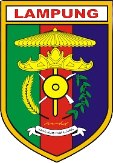
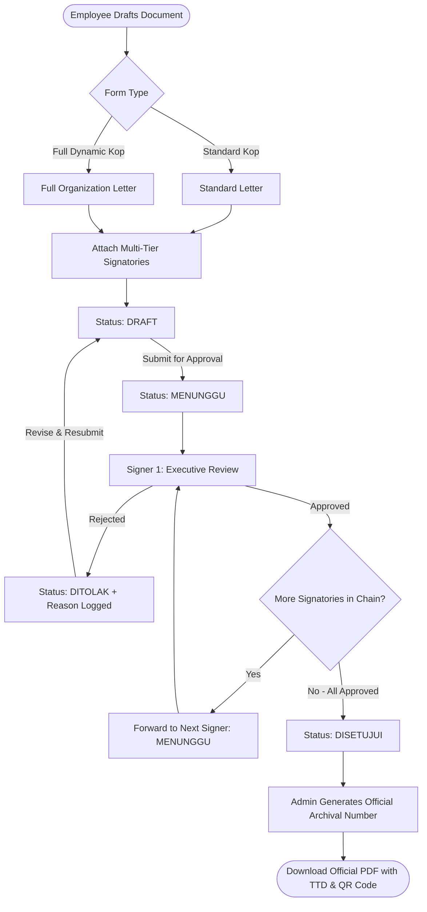
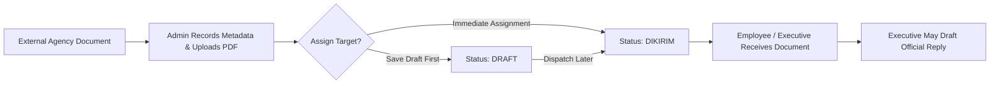
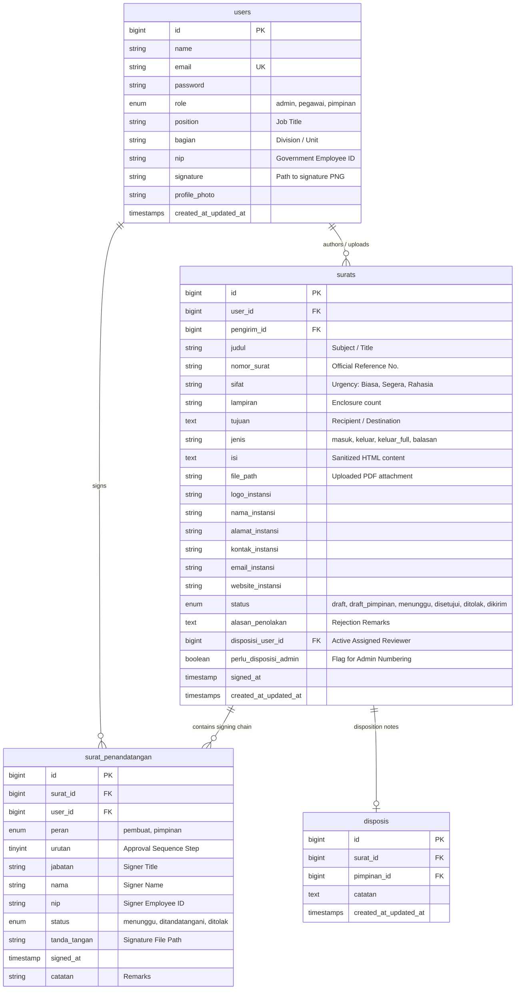

# SIDORA - Enterprise Digital Document & Official Correspondence Management System

<p align="center">
  
</p>

<p align="center">
  <strong>An open-source, modern E-Office and Government/Enterprise Document Management System built with Laravel 10, featuring hierarchical multi-tier digital signature workflows, automatic official letter numbering, and QR-verified PDF generation.</strong>
</p>

<p align="center">
  <a href="https://laravel.com"></a>
  <a href="https://php.net"></a>
  <a href="https://tailwindcss.com"></a>
  <a href="https://alpinejs.dev"></a>
  <a href="https://opensource.org/licenses/MIT"></a>
  <a href="https://github.com"></a>
</p>

---

## 📌 Table of Contents

- [Overview](#-overview)
- [Key Features](#-key-features)
- [Workflow & Architecture](#-workflow--architecture)
- [Technology Stack](#-technology-stack)
- [Database Schema & ERD](#-database-schema--erd)
- [Installation Guide](#-installation-guide)
- [Default Demo Credentials](#-default-demo-credentials)
- [Official Letter Numbering Format](#-official-letter-numbering-format)
- [API Endpoints](#-api-endpoints)
- [Security & Production Checklist](#-security--production-checklist)
- [Contributing](#-contributing)
- [License](#-license)

---

## 🌟 Overview

**SIDORA** (*Sistem Informasi Dokumen Resmi Aplikasi*) is an enterprise-grade document management and e-correspondence web platform (*Tata Naskah Dinas Elektronik / E-Office*). Built specifically to streamline institutional correspondence, SIDORA solves the inefficiencies of manual paper-based approval by digitizing drafting, multi-stakeholder approval chains, archival numbering, and legal document generation into an automated, transparent pipeline.

Whether for public sector institutions, governmental agencies, or corporate enterprises, SIDORA provides rigorous Role-Based Access Control (RBAC), end-to-end document tracking, and tamper-resistant PDF generation with digital signature timestamps and QR verification codes.

---

## 🚀 Key Features

### 🛡️ 1. Multi-Tier Role-Based Access Control (RBAC)
- **Administrator:** Complete oversight of the agency’s correspondence, user lifecycle management, incoming external mail registration, official letter numbering generation, and master archival reports.
- **Staff / Employee (Author):** Draft official outgoing letters with custom headers, define sequential multi-signers, upload external PDF documents, submit approval requests, and monitor review statuses in real time.
- **Executive / Leadership (Approver):** Review pending drafts, grant hierarchical approvals with one-click digital signatures, forward or reject with mandatory audit remarks, and create reply correspondence (*Surat Balasan*).
- **Special Governance Rule:** High-ranking executive accounts (e.g., *Head of Department / Kepala Dinas*) automatically bypass drafting restrictions to function strictly as final authorizing signatories.

### ✍️ 2. Advanced Document Drafting & Custom Letterheads
- **Quill 2.0 Rich Text Editor:** Fast, responsive formatting support including typography, alignments (left, center, right, justify), indents, bullet points, and tables.
- **Flexible Letterhead Modes:**
  - `keluar` *(Standard)*: Built-in formal institutional header.
  - `keluar_full` *(Dynamic Organization)*: Complete formal agency letterhead with custom logo upload, institution name, full address, phone number, email, and website.
- **XSS Sanitization:** Powered by **HTMLPurifier** to cleanse malicious scripts before saving to the database.

### 🔄 3. Sequential Multi-Signer Approval Chain
- Define sequential signatories ($Urutan\ 1 \rightarrow 2 \rightarrow \dots \rightarrow N$).
- Author's signature is automatically affixed upon draft creation using their transparent digital profile signature.
- **Intelligent Auto-Matching:** Automatically assigns pending approvals to the correct executive user by matching organizational units (*Bidang/Bagian*) and job titles (*Jabatan*).
- **Sequential Notification Chain:** Approving an order instantly advances the document to the next executive in line. Full approval routes the document to the Administrator for official registration.

### 📑 4. Automated Archival & Letter Numbering Engine
- Generates official document numbers adhering to standard regional and governmental archival taxonomy:
  $$\text{\{Classification Code\}} / \text{\{Sequence Number\}} / \text{\{Agency Unit Code\}} / \text{\{Month\}} / \text{\{Year\}}$$
- Automatically detects the highest sequence for the current calendar year and auto-pads numbers to 4 digits (e.g., `0001`, `0002`).

### 📄 5. Dynamic A4 PDF Rendering with QR Verification
- High-fidelity PDF rendering via **DomPDF** designed to meet formal government document spacing standards.
- **Adaptive Signer Grids:** Perfectly aligns single signers, side-by-side signatories, or dual-row 4-signer matrixes with aligned names and Employee IDs (*NIP*).
- **Embedded QR Code Validation:** Real-time QR codes generated with **Simple QrCode** linking to instant document validity verification.

### 👤 6. Interactive User Profile & Signature Management
- Integrated **Cropper.js** widget allowing users to crop, rotate, zoom, and fit profile photos into a clean 1:1 circular badge.
- Dedicated transparent digital signature upload (PNG) used across all generated PDF credentials.

---

## 🔄 Workflow & Architecture

### Outgoing Letter Workflow (Persetujuan Naskah Dinas Keluar)



### Incoming Mail Flow (Pencatatan Surat Masuk)



---

## 💻 Technology Stack

| Layer | Technology | Details |
| :--- | :--- | :--- |
| **Backend Framework** | [Laravel 10.x](https://laravel.com/) | MVC Architecture, Eloquent ORM, Sanctum Auth |
| **Language Runtime** | [PHP 8.1+](https://php.net/) | Modern PHP features, typing, and attributes |
| **Database** | [MySQL](https://www.mysql.com/) / [MariaDB](https://mariadb.org/) | Relational database with strict foreign constraints |
| **PDF Engine** | [laravel-dompdf](https://github.com/barryvdh/laravel-dompdf) | Converts Blade views to print-ready A4 PDFs |
| **QR Code Generator** | [simple-qrcode](https://github.com/SimpleSoftwareIO/simple-qrcode) | Generates crisp SVG / PNG QR validation codes |
| **HTML Sanitizer** | [mews/purifier](https://github.com/mewebstudio/Purifier) | HTMLPurifier wrapper for bulletproof XSS defense |
| **Frontend Styling** | [Tailwind CSS](https://tailwindcss.com/) (CDN) | Modern utility-first CSS framework |
| **Frontend Reactivity**| [Alpine.js 3.x](https://alpinejs.dev/) (CDN) | Lightweight state management for modals & dropdowns |
| **Rich Text Editor** | [Quill 2.0.2](https://quilljs.com/) (CDN) | Clean typography, alignment, and table support |
| **Image Cropper** | [Cropper.js 1.5](https://fengyuanchen.github.io/cropperjs/) (CDN) | Interactive canvas image cropping & rotating |
| **Icons** | [Font Awesome 6](https://fontawesome.com/) | Standard UI iconography |
| **Build Tool** | [Vite 4](https://vitejs.dev/) | Frontend asset compilation |

---

## 🗄️ Database Schema & ERD



---

## ⚙️ Installation Guide

Follow these steps to set up SIDORA on your local development server (Laragon, XAMPP, or Linux LEMP/LAMP):

### 1. Clone Repository & Install Dependencies
```bash
# Clone the repository
git clone https://github.com/your-username/sidora.git
cd sidora

# Install PHP dependencies
composer install

# Install NPM packages
npm install
```

### 2. Configure Environment
```bash
# Duplicate example environment file
cp .env.example .env

# Generate unique application key
php artisan key:generate
```

Configure your `.env` database settings:
```env
APP_NAME=SIDORA
APP_ENV=local
APP_DEBUG=true
APP_URL=http://localhost:8000

DB_CONNECTION=mysql
DB_HOST=127.0.0.1
DB_PORT=3306
DB_DATABASE=sidora
DB_USERNAME=root
DB_PASSWORD=
```

### 3. Run Migrations & Seeders
```bash
# Create the database 'sidora' first in MySQL, then run:
php artisan migrate --seed

# Symlink public storage for file uploads
php artisan storage:link

# Compile assets
npm run build
```

### 4. Serve the Application
```bash
php artisan serve
```
Open **`http://localhost:8000`** in your browser.

> **💡 Note for Windows / Laragon Users:**
> On certain Windows installations, symbolic links created by `storage:link` may encounter permission quirks. SIDORA includes an automatic fallback route at `/storage/{path}` inside `routes/web.php` to guarantee signatures, profile pictures, and letterhead logos render reliably out of the box.

---

## 🔑 Default Demo Credentials

The database seeder initializes 3 pre-configured testing accounts:

| Role | Email | Password | Access Scope |
| :--- | :--- | :--- | :--- |
| **Admin** | `admin@example.com` | `admin123` | System Administrator & Archival Officer |
| **Staff (Pegawai)** | `pegawai@example.com` | `pegawai123` | Document Author / Creator |
| **Executive (Pimpinan)** | `pimpinan@example.com` | `pimpinan123` | Reviewer & Signing Authority |

> **⚠️ Security Notice:** Always update passwords and change these default accounts immediately before deploying to staging or production.

---

## 📑 Official Letter Numbering Format

When an outgoing letter reaches the `disetujui` (approved) status, Administrators generate the formal reference number directly from the dashboard:

$$\mathbf{\{Classification\ Code\} / \{Sequence\ Number\} / \{Unit\ Code\} / \{Month\} / \{Year\}}$$

**Example:** `500.15.6.1/0001/DISNAKER/11/2026`

- **Sequence Number:** Automatically calculated as the next 4-digit zero-padded number (`0001`, `0002`...) for the current year.
- **Classification Code:** Picked from the built-in catalog based on standard governance archiving classifications (e.g., `500.15.x` for Employment & Apprenticeship, `800` for Personnel & Civil Service, `000` for General Administration).

---

## 🔌 API Endpoints

SIDORA includes starter API endpoints ready for mobile or microservice integration:

| Method | Endpoint | Auth Middleware | Description |
| :--- | :--- | :--- | :--- |
| `GET` | `/api/user` | `auth:sanctum` | Retrieve authenticated user profile |
| `PUT` | `/api/pegawai/surat/{id}` | Standard API | Update draft letter metadata |

---

## 🛡️ Security & Production Checklist

Before deploying SIDORA to a public server:

1. **Environment Configuration:** Set `APP_ENV=production` and `APP_DEBUG=false` in `.env`.
2. **Caching:** Warm up configuration, route, and view caches:
   ```bash
   php artisan config:cache
   php artisan route:cache
   php artisan view:cache
   ```
3. **Storage Permissions:** Ensure `storage/` and `bootstrap/cache/` directories are writable by the web server user (`www-data` or `nginx`).
4. **HTTPS Enforcement:** Always enforce SSL/TLS to protect confidential official documents and digital signatures transmitted in transit.
5. **Private Storage:** Keep sensitive PDF attachments in restricted directories with authenticated download streaming.

---

## 🤝 Contributing

Contributions make the open-source community an amazing place to learn, inspire, and create. Any contributions you make are **greatly appreciated**.

1. Fork the Project
2. Create your Feature Branch (`git checkout -b feature/AmazingFeature`)
3. Commit your Changes (`git commit -m 'Add some AmazingFeature'`)
4. Push to the Branch (`git push origin feature/AmazingFeature`)
5. Open a Pull Request

---

## 📄 License

This project is licensed under the **MIT License** - see the [LICENSE](LICENSE) file for details. Built upon the [Laravel Framework](https://laravel.com).
